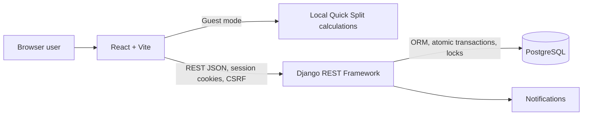

# Splitter — Engineering Case Study

[Backend README](../README.md) · [React frontend](https://github.com/amanzx-git/expense-splitter-frontend) · [GitHub profile](https://github.com/amanzx-git)

## Project at a glance

**Splitter** is a full-stack group expense-sharing application. Users can create groups, invite members, record shared expenses, inspect balances, generate settlements, and track whether payment was reported and confirmed. A separate **Quick Split** mode works entirely in the browser without requiring an account.

| Layer | Technologies | Responsibility |
| --- | --- | --- |
| Client | React, Vite, React Router | Forms, group views, Quick Split, settlement and payment interfaces |
| API | Python, Django, Django REST Framework | Validation, session authentication, access control, business rules |
| Data | PostgreSQL | Relational integrity, transactional updates, concurrent write safety |
| Quality | Django tests, Vitest, React Testing Library | Backend and frontend behavior; integration validation |

**Development status:** The project is under active development and being prepared for production deployment. A production URL and operational claims will be added only after they are verified.

## System architecture



The diagram describes the logical application components, **not** deployed cloud infrastructure.

## The engineering problem

A group expense tracker must be correct under more than ideal conditions. Different users may edit expenses concurrently; an equal split may not divide neatly into whole paise; and a payer reporting a transfer must not automatically mark it as received.

Splitter separates three concerns:
1. **Calculation** — who owes how much.
2. **Authorization and persistence** — who is allowed to change records and when.
3. **Payment status** — what participants reported and confirmed, without moving funds.

## Key design decisions

### Exact and deterministic money calculations

Financial values are handled in **integer paise**, not binary floating-point amounts. An expense is allocated among selected participants; if the division leaves a remainder, the extra paise go to participants in deterministic UUID order. The total allocated equals the original expense.

### Protecting concurrent operations

The backend uses atomic database transactions and a consistent **group-first locking order** before relevant financial modifications. Settlement creation freezes eligible expenses in a snapshot so subsequent changes cannot silently rewrite an existing settlement.

### Payment acknowledgement instead of payment processing

The person who owes money can report a transfer; the recipient confirms receipt. A UPI payment link or QR is a convenience, **not** evidence that money was transferred. The app does not integrate with bank accounts or act as a payment processor.

### Guest mode independent of server health

Quick Split is implemented on the React side. It does not require authentication or a network call to calculate guest-only expenses. Authenticated group workflows rely on the backend and show recoverable errors if it is unavailable.

## Typical user journey

```text
Register and verify email
       |
Create or join a group
       |
Add shared expenses (payer + selected participants)
       |
Review unsettled balances
       |
Group admin generates settlement
       |
Payer reports payment
       |
Receiver confirms receipt
       |
Settlement completes when all required payments are confirmed
```

## Security and reliability considerations

- Session-based authentication and CSRF protection for state-changing requests.
- Group membership and role checks enforced in the API, not merely hidden in the UI.
- Validation of expenses and financial-state transitions.
- Frozen settlement records and transaction handling to protect accounting consistency.
- User-specific notifications and permissions around payment acknowledgements.
- Tests for financial rules, access controls, and important concurrent operations.

## Code map

| Area | Repository |
| --- | --- |
| Django models, APIs, tests, financial logic | [Backend](https://github.com/amanzx-git/expense-splitter-backend) |
| React screens, Quick Split, UI and component tests | [Frontend](https://github.com/amanzx-git/expense-splitter-frontend) |

## Next engineering milestone

Deploy the separate frontend and backend, secure production configuration, add monitoring and backups, and document the verified live environment. This is a planned milestone—not a claim that AWS, CI/CD deployment, or production monitoring is already operational.

---

**Author:** Aman Yadav · [GitHub](https://github.com/amanzx-git) · [LinkedIn](https://www.linkedin.com/in/aman-yadav-profile)
